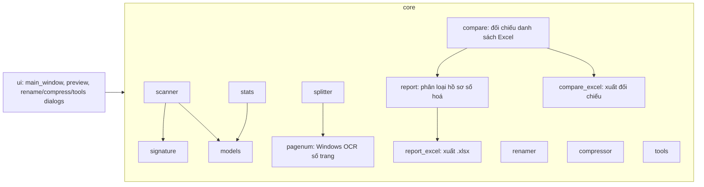

# PDF-Read Pro

Ứng dụng đọc và xử lý PDF (PySide6 + PyMuPDF + pikepdf), giao diện theo phong cách Hồ sơ 1361.
Chạy ngay: `dist\PDFReadPro.exe` (1 file, không cần cài, không cần quyền Admin).

## Bố cục (v1.5 – phong cách Hồ sơ 1361, gọn hơn)
```
PDF-READ PRO  (banner 1 dòng)                                                         v1.5.0
┌ Cấu hình & Thư mục nguồn ──────────────────────────────────────────────────────────────┐
│ Thư mục: [...............................................] [Chọn thư mục] [Quét] [Clear]│
│ ☑ Quét thư mục con  Tính số trang: [Tất cả ▾]   Công cụ: [Đủ 5 file][CCCD][Copy][☰ Thêm]│
└────────────────────────────────────────────────────────────────────────────────────────┘
[Tổng quan][Đổi tên][Tách trang][Giảm dung lượng][Báo cáo hồ sơ][Bộ quy tắc][Hướng dẫn]
  …nội dung tab…
Trạng thái + thanh tiến trình                                                 [📜 Nhật ký]
```

## Hướng dẫn nhanh
1. **Chọn thư mục** (hoặc kéo thả thư mục vào cửa sổ) → **Quét** (F5).
2. **Tab Tổng quan**: 5 thẻ thống kê (bấm thẻ xem danh sách, rê chuột xem giải thích), cây thư mục, xem trước PDF.
   Bấm 1 thư mục → mọi tab chỉ tính thư mục đó (nút *✖ Xem toàn bộ* để quay lại).
   | Thẻ | Ý nghĩa |
   |---|---|
   | Thư mục có PDF | Số thư mục có file PDF **nằm trực tiếp** trong nó. Thư mục chỉ chứa thư mục con không đếm (ghi ở dòng phụ) |
   | Số file / Tổng số trang | Theo lựa chọn *Tính số trang*; dòng phụ luôn hiện cả nhóm .signed / không .signed |
   | Chữ ký số | Chữ ký **thật** trong file: ✔ nguyên · ⚠ sửa sau ký · ✖ hỏng |
   | Cần xem lại | Ký thật nhưng tên chưa `.signed` · tên `.signed` không có chữ ký · không đọc được · file lỗi |
3. **Tab Xem trước & đổi tên** – mặc định theo **bộ quy tắc mã số 1361** (124 quy tắc chép nguyên từ Hồ sơ 1361):
   mã ở đầu tên (`01`, `1.`, `07a`, `86dh`, `6124`) → tên mẫu tiêu chuẩn; nhiều file cùng mã trong thư mục → `.1`, `.2`…;
   tuỳ chọn *Luôn thêm hậu tố .1*; giữ `.signed`. Bảng: Mã Số · Quy Tắc Khớp · Tên File Mới Dự Kiến · Trạng Thái; xem trước PDF bên phải;
   **BẮT ĐẦU ĐỔI TÊN HÀNG LOẠT** / **HOÀN TÁC (UNDO)**. Không bao giờ ghi đè; có nhật ký chống mất điện. Có thể chọn mẫu tuỳ chỉnh.
4. **Tab Quản lý bộ quy tắc** – tab con *Bộ quy tắc mã số 1361* (bảng Mã → Tên mẫu, Thêm/Cập nhật, Xoá, tìm kiếm,
   Nhập/Xuất .json/.txt, Reset mặc định) và *Mẫu đổi tên tuỳ chỉnh (nâng cao)* (mẫu có biến, đánh số, các bước biến đổi).
5. **Tab Tách trang PDF** (như "Cắt & Ghép Sổ Lý Lịch" của Hồ sơ 1361) – mẫu *A3 ngang → 2 trang A4*, *A4 → 2 nửa phóng thành A4*,
   *Sổ lý lịch gỡ ghim scan 2 mặt* (sắp lại đúng thứ tự, giữ bìa, xoay mặt sau ADF). Trang gốc có đường cắt đỏ, xem trước kết quả
   giống 100% file xuất; bỏ trang trắng; xuất trang chỉ định; lưu ra `…_DaTach.pdf` (không ghi đè, tuỳ chọn lưu đè có sao lưu).
   **🔢 Tự đọc số trang** (v1.4): OCR có sẵn của Windows đọc số in ở đầu/chân trang → tự chọn cách xếp sổ (tờ ngoài/tờ giữa trước,
   mặt nào trước, mặt sau/cả xấp lộn ngược) – không phụ thuộc cách đặt sổ vào máy scan.
6. **Tab Giảm dung lượng PDF**: giới hạn KB/trang, phân tích, nén đa tiến trình; mặc định lưu thư mục mới và bỏ qua file đã ký số.
   Dung lượng **từng trang là đo thật** (tách riêng từng trang ra PDF trong RAM rồi đo – giống app Giamdungluong_Full cũ),
   không phải lấy dung lượng file chia số trang. Nén theo từng trang: trang đạt ở bậc nào dừng ở bậc đó (giữ chất lượng
   cao nhất), app dự đoán bậc cần nén rồi đo lại để chắc chắn đạt. Bậc nén mịn, ưu tiên giữ nguyên độ phân giải.
   So với Giamdungluong_Full (cùng file scan 40 trang 40,5 MB, giới hạn 300 KB/trang): 1 file 24 s → 3 s;
   thư mục 6 file 34,6 s → 4,8 s; chữ nét hơn (app cũ hạ JPEG xuống q29 ở 200 dpi).
7. **Tab Báo cáo hồ sơ** (v1.5) – cấu trúc chuẩn `Hồ sơ số hóa\<Chi bộ>\<CCCD>_<HoVaTen>\*.pdf`
   (VD `056123456789_TranVanThai`, tên file theo bộ quy tắc 1361, bắt buộc 01–05). Mỗi người: **Đủ** / **Thiếu** + cột
   **Còn thiếu**; vấn đề khác ở **Ghi chú**. **Tính file**: cả 2 / chỉ đã ký (.signed) / chỉ chưa ký. Lọc Đủ / Thiếu / Thiếu từng mục; chuẩn hoá tên thư mục (có hoàn tác).
   **Xuất Excel**: Tổng hợp chi bộ · Danh sách toàn bộ · Danh sách thiếu · Giải thích (+ nâng cao: Chi tiết file ·
   Thống kê giấy tờ 124 mã · Vấn đề cần xử lý). Dữ liệu test lớn: `py tests\make_big_dataset.py`.
8. **Tab Đối chiếu danh sách** (v1.6) – nạp file Excel danh sách đảng viên của hệ thống (.xlsx), tự dò dòng tiêu đề và
   cột Số CCCD / Họ tên / Chi bộ (chỉnh bằng ô chọn có ví dụ, hoặc bấm tiêu đề cột trong bảng xem trước; tên cột lạ thì tự tìm cột CCCD theo dữ liệu, cảnh báo nếu chọn nhầm). So theo CCCD: Khớp · Lệch tên · Khác chi bộ · Nghi gõ nhầm CCCD ·
   Chưa có thư mục · Ngoài danh sách, kèm tình trạng hồ sơ 01–05. Tự sửa CCCD mất số 0 đầu. Thao tác (có hoàn tác):
   đổi tên thư mục theo danh sách, chuyển về đúng chi bộ, tạo thư mục còn thiếu. Xuất Excel đối chiếu 6 trang.
   File mẫu: `py tests\make_system_excel.py` (kèm đáp án).
9. **Công cụ** cạnh ô thư mục: kiểm tra đủ 5 file `01.`–`05.`, thư mục CCCD 12 số (xoá vào Thùng rác), copy nhóm file giữ cây thư mục;
   **☰ Thêm**: mở thư mục nguồn, nhật ký, dữ liệu ứng dụng.

Ứng dụng luôn dùng giao diện sáng, kể cả khi Windows bật chế độ tối.

Dữ liệu người dùng (bộ quy tắc, nhật ký, lịch sử đổi tên): `%APPDATA%\PDFReadPro`.

## Phát triển
```powershell
pip install -r requirements.txt
py main.py                      # chạy từ mã nguồn
py -m unittest discover -s tests  # test lõi + tách trang + tự đọc số trang
py tests\integration_gui.py     # test tích hợp (dùng bản sao dữ liệu mẫu)
py build.py                     # đóng gói dist\PDFReadPro.exe (1 file, portable)
py build.py --dir               # đóng gói thư mục dist\PDFReadPro\ (mở nhanh hơn, dùng cho bộ cài)
py main.py --selftest out.txt   # tự kiểm tra (cũng chạy được với exe)
```
Bộ cài (cần Inno Setup 6): `py build.py --dir` rồi `ISCC.exe installer.iss` → `dist\Setup_PDFReadPro_1.6.1.exe`.
Bản build lọc bỏ thư viện / plugin Qt app không dùng (xem `build.py`): exe 1 file ~59 MB, mở ~1,8 giây;
bản thư mục mở ~0,9 giây.


