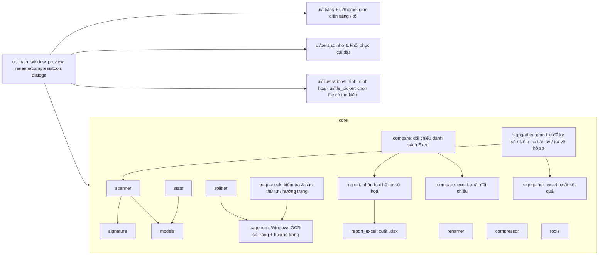

# PDF-Read Pro

Ứng dụng đọc và xử lý PDF (PySide6 + PyMuPDF + pikepdf), giao diện theo phong cách Hồ sơ 1361.
Chạy ngay: `dist\PDFReadPro.exe` (1 file, không cần cài, không cần quyền Admin).

## Bố cục (v1.8 – phong cách Hồ sơ 1361, gọn hơn)
```
PDF-READ PRO  (banner 1 dòng)                                            [🌙 Tối]  v1.8.0
┌ Cấu hình & Thư mục nguồn ──────────────────────────────────────────────────────────────┐
│ Thư mục: [...............................................] [Chọn thư mục] [Quét] [Clear]│
│ ☑ Quét thư mục con  Tính số trang: [Tất cả ▾]   Công cụ: [Đủ 5 file][CCCD][Copy][☰ Thêm]│
└────────────────────────────────────────────────────────────────────────────────────────┘
[Tổng quan][Đổi tên][Tách trang][Kiểm tra trang][Giảm dung lượng][Báo cáo hồ sơ][Gom ký số][Đối chiếu][Bộ quy tắc][Hướng dẫn]
  …nội dung tab… (màn hình nhỏ: mỗi tab tự có thanh cuộn, thanh công cụ thu gọn còn biểu tượng)
Trạng thái + thanh tiến trình                                                 [📜 Nhật ký]
```

## Hướng dẫn nhanh
1. **Chọn thư mục** (hoặc kéo thả thư mục vào cửa sổ) → **Quét** (F5).
2. **Tab Tổng quan**: 5 thẻ thống kê (bấm thẻ xem danh sách, rê chuột xem giải thích), cây thư mục, xem trước PDF.
   Bấm 1 thư mục → mọi tab chỉ tính thư mục đó (nút *✖ Xem toàn bộ* để quay lại).
   | Thẻ | Ý nghĩa |
   |---|---|
   | Thư mục có PDF | Số thư mục có file PDF **nằm trực tiếp** trong nó. Thư mục chỉ chứa thư mục con không đếm (ghi ở dòng phụ) |
   | Số file / Tổng số trang | Theo lựa chọn *Tính số trang*; dòng phụ luôn hiện cả nhóm .signed / không .signed |
   | Chữ ký số | Chữ ký **thật** trong file: ✔ nguyên · ⚠ sửa sau ký · ✖ hỏng |
   | Cần xem lại | Ký thật nhưng tên chưa `.signed` · tên `.signed` không có chữ ký · không đọc được · file lỗi |
3. **Tab Xem trước & đổi tên** – mặc định theo **bộ quy tắc mã số 1361** (124 quy tắc chép nguyên từ Hồ sơ 1361):
   mã ở đầu tên (`01`, `1.`, `07a`, `86dh`, `6124`) → tên mẫu tiêu chuẩn; nhiều file cùng mã trong thư mục → `.1`, `.2`…;
   tuỳ chọn *Luôn thêm hậu tố .1*; giữ `.signed`. Bảng: Mã Số · Quy Tắc Khớp · Tên File Mới Dự Kiến · Trạng Thái; xem trước PDF bên phải;
   **BẮT ĐẦU ĐỔI TÊN HÀNG LOẠT** / **HOÀN TÁC (UNDO)**. Không bao giờ ghi đè; có nhật ký chống mất điện. Có thể chọn mẫu tuỳ chỉnh.
4. **Tab Quản lý bộ quy tắc** – tab con *Bộ quy tắc mã số 1361* (bảng Mã → Tên mẫu, Thêm/Cập nhật, Xoá, tìm kiếm,
   Nhập/Xuất .json/.txt, Reset mặc định) và *Mẫu đổi tên tuỳ chỉnh (nâng cao)* (mẫu có biến, đánh số, các bước biến đổi).
5. **Tab Tách trang PDF** (như "Cắt & Ghép Sổ Lý Lịch" của Hồ sơ 1361) – mẫu *A3 ngang → 2 trang A4*, *A4 → 2 nửa phóng thành A4*,
   *Sổ lý lịch gỡ ghim scan 2 mặt* (sắp lại đúng thứ tự, giữ bìa, xoay mặt sau ADF). Trang gốc có đường cắt đỏ, xem trước kết quả
   giống 100% file xuất; bỏ trang trắng; xuất trang chỉ định; lưu ra `…_DaTach.pdf` (không ghi đè, tuỳ chọn lưu đè có sao lưu).
   **🔢 Tự đọc số trang** (v1.4): OCR có sẵn của Windows đọc số in ở đầu/chân trang → tự chọn cách xếp sổ (tờ ngoài/tờ giữa trước,
   mặt nào trước, mặt sau/cả xấp lộn ngược) – không phụ thuộc cách đặt sổ vào máy scan.
   **v1.8 – dễ dùng hơn:** dải 4 bước (chọn file → bấm hình kiểu tách → xem Kết quả → Lưu); **🔎 Chọn file…** mở hộp chọn
   có ô tìm kiếm (tên file / CCCD / tên người / thư mục, không cần dấu) và cây theo thư mục – thay danh sách thả xuống
   hàng nghìn dòng; nút **◀ ▶** sang file trước / sau; **kéo thả** file PDF vào tab; chọn kiểu tách bằng **3 thẻ có hình
   minh hoạ**; **kéo đường cắt đỏ bằng chuột** trên trang scan (hiện %, kết quả cập nhật ngay); cột thiết lập tự cuộn
   nên thanh **Lưu** luôn hiện; nút **❓ Hướng dẫn có hình**. File mẫu để thử: `py tests\make_booklet_sample.py`
   (sổ 12 trang gỡ ghim, mặt sau lộn ngược, có số trang ở chân trang).
6. **Tab Giảm dung lượng PDF**: giới hạn KB/trang (**mặc định 250 KB**, nhớ lần chọn trước), phân tích, nén đa tiến trình;
   mặc định lưu thư mục mới và bỏ qua file đã ký số. **Xem trước** bên phải, nút **Bản gốc ↔ Bản đã nén** (giữ đúng trang)
   để so độ rõ chữ.
   **✨ Rõ chữ** (mặc định bật, v1.7): làm trắng nền giấy (giấy & nhiễu → trắng, mực đậm hơn; tự bỏ qua trang ảnh/tối),
   trang không có màu lưu ảnh xám (dấu đỏ, chữ ký màu → giữ màu). Ảnh > 300 dpi luôn hạ về 300 dpi.
   Dung lượng **từng trang là đo thật** (tách riêng từng trang ra PDF trong RAM rồi đo – giống app Giamdungluong_Full cũ),
   không phải lấy dung lượng file chia số trang. Nén theo từng trang: trang đạt ở bậc nào dừng ở bậc đó (giữ chất lượng
   cao nhất), app dự đoán bậc cần nén rồi đo lại để chắc chắn đạt. Bậc nén mịn, ưu tiên giữ nguyên độ phân giải.
   So với Giamdungluong_Full (cùng file scan 40 trang 40,5 MB, giới hạn 300 KB/trang): 1 file 24 s → 3 s;
   thư mục 6 file 34,6 s → 4,8 s; chữ nét hơn (app cũ hạ JPEG xuống q29 ở 200 dpi).
   **Nghiên cứu "nén rõ chữ" (v1.7)** – trang A4 scan 300 dpi chữ tiếng Việt dày, nhiễu mạnh (2,1 MB/trang) nén còn 250 KB:
   | Cách | Độ giống chữ sạch |
   |---|---|
   | Giữ 300 dpi, ép JPEG q8 | 0,905 (vỡ khối quanh dấu) |
   | **~250 dpi, JPEG q13–17** | **0,983–0,986** |
   | ~200 dpi, JPEG q26–30 | 0,972–0,984 |
   | ~150 dpi | 0,966–0,970 (chữ nhỏ mờ, OCR sai nhiều hơn) |
   → bậc nén hạ độ phân giải về ~250 rồi ~200 dpi trước khi ép chất lượng; làm trắng nền cho chữ dễ đọc nhất
   (cùng dung lượng). Sau khi dự đoán bậc, trang còn < 75% giới hạn được thử lùi 1 bậc nhẹ hơn (chỉ ghi khi chắc chắn đạt).
7. **Tab Báo cáo hồ sơ** (v1.5) – cấu trúc chuẩn `Hồ sơ số hóa\<Chi bộ>\<CCCD>_<HoVaTen>\*.pdf`
   (VD `056123456789_TranVanThai`, tên file theo bộ quy tắc 1361, bắt buộc 01–05). Mỗi người: **Đủ** / **Thiếu** + cột
   **Còn thiếu**; vấn đề khác ở **Ghi chú**. **Tính file**: cả 2 / chỉ đã ký (.signed) / chỉ chưa ký. Lọc Đủ / Thiếu / Thiếu từng mục; chuẩn hoá tên thư mục (có hoàn tác).
   **Xuất Excel**: Tổng hợp chi bộ · Danh sách toàn bộ · Danh sách thiếu · Giải thích (+ nâng cao: Chi tiết file ·
   Thống kê giấy tờ 124 mã · Vấn đề cần xử lý). Dữ liệu test lớn: `py tests\make_big_dataset.py`.
8. **Tab Đối chiếu danh sách** (v1.6) – nạp file Excel danh sách đảng viên của hệ thống (.xlsx), tự dò dòng tiêu đề và
   cột Số CCCD / Họ tên / Chi bộ (chỉnh bằng ô chọn có ví dụ, hoặc bấm tiêu đề cột trong bảng xem trước; tên cột lạ thì tự tìm cột CCCD theo dữ liệu, cảnh báo nếu chọn nhầm). So theo CCCD: Khớp · Lệch tên · Khác chi bộ · Nghi gõ nhầm CCCD ·
   Chưa có thư mục · Ngoài danh sách, kèm tình trạng hồ sơ 01–05. Tự sửa CCCD mất số 0 đầu. Thao tác (có hoàn tác):
   đổi tên thư mục theo danh sách, chuyển về đúng chi bộ, tạo thư mục còn thiếu. Xuất Excel đối chiếu 6 trang.
   File mẫu: `py tests\make_system_excel.py` (kèm đáp án).
9. **Công cụ** cạnh ô thư mục: kiểm tra đủ 5 file `01.`–`05.`, thư mục CCCD 12 số (xoá vào Thùng rác), copy nhóm file giữ cây thư mục;
   **☰ Thêm**: mở thư mục nguồn, nhật ký, dữ liệu ứng dụng.

**Tab Gom ký số** (v1.8) – ký số hàng loạt cho nhiều hồ sơ `CCCD_HoVaTen`:
1. **① Gom để ký**: CHÉP file **chưa ký** (bỏ file `.signed` và file đã có bản `.signed` cạnh nó) vào 1 thư mục
   (mặc định `<thư mục quét> - Gom ký số`), tên thêm đuôi hồ sơ:
   `056123456789_TranVanThai\01.Ly_lich_nguoi_xin_vao_Dang.pdf` → `01.Ly_lich_nguoi_xin_vao_Dang_056123456789_TranVanThai.pdf`.
   File gốc giữ nguyên; sổ `_gom_ky_so.json` trong thư mục gom ghi file nào của hồ sơ nào.
2. Ký số hàng loạt bằng phần mềm ký (tạo thêm `….signed.pdf`, không ghi đè).
3. **② Trả về sau ký** (bấm *Kiểm tra trả về* để xem trước): bản `.signed` được CHUYỂN về đúng hồ sơ, bỏ đuôi
   (`01.Ly_lich_nguoi_xin_vao_Dang.signed.pdf`); bản chưa ký giống hệt bản gốc → xoá bản sao; file chưa ký xong giữ
   lại để ký tiếp. Không ghi đè: hồ sơ đã có file cùng tên khác nội dung → báo *xung đột*, giữ lại. Mất sổ ghi
   (chép thư mục gom sang máy khác) vẫn nhận hồ sơ theo đuôi `_CCCD_HoVaTen`. Có **↶ Hoàn tác**.
   Hoặc chọn **Chép ra thư mục mới** (mặc định, `<thư mục quét> - Đã ký`): hồ sơ gốc + thư mục gom giữ nguyên;
   thư mục mới cùng cây `Chi bộ\CCCD_HoVaTen\` chứa bản `.signed` + bản chưa ký (bỏ đuôi); tuỳ chọn **Chép kèm đủ bộ
   hồ sơ** (các file khác của hồ sơ) → bộ hồ sơ hoàn chỉnh để nộp. Không ghi đè; hoàn tác = xoá file vừa chép.

Sổ `_gom_ky_so.json` được **ẩn** (Ctrl+A trong Explorer / phần mềm ký không chọn nhầm); phần mềm ký chỉ ký PDF nên
không lỗi, app cũng chỉ đọc file `.pdf`. Sổ hỏng / bị xoá → app vẫn nhận hồ sơ theo đuôi `_CCCD_HoVaTen`.
Trả về / chép ra không cần quét: app suy thư mục hồ sơ gốc từ sổ (`guess_root`) và tự đặt thư mục mới.
Kiểm tra trả về và hoàn tác chạy ở luồng phụ (5.242 file: 13 s đứng máy → 0,3 s, giao diện không khựng).

**Chống lỗi khi trả về** (v1.8):

| Kiểm tra | Sai thì |
|---|---|
| Bản ký có **chữ ký số thật** (băm lại vùng ký, không chỉ đổi tên `.signed`) | *Không có chữ ký thật* / *Chữ ký hỏng* – giữ lại |
| Bản ký mở được, không rỗng, **cùng số trang** bản gốc (chống ký nhầm file) | *Bản ký lỗi* / *Lệch số trang* – giữ lại |
| Phần mềm ký **đã ghi xong** (file không đổi trong 5 giây, không bị khoá) | *Đang ghi* – tự kiểm tra lại sau vài giây |
| Bản gốc **không bị thay** sau khi gom (sổ lưu kích thước + ngày sửa) | *Bản gốc đã đổi* – cần gom & ký lại |
| 2 chi bộ có **thư mục hồ sơ trùng tên** | không gom, báo đường dẫn trùng |
| Đường dẫn > 250 ký tự | cảnh báo; app vẫn chép / chuyển được (đường dẫn `\\?\`) |
| Ổ đích **không đủ chỗ** | báo trước, chưa chép file nào |

Chép qua file `.part` rồi mới đổi tên (mất điện không để lại file dở). Nhật ký hoàn tác lưu ra file
(`%APPDATA%\PDFReadPro\gom_ky_so_hoan_tac.json`, ghi mỗi 100 file) → tắt app / lỗi giữa chừng vẫn hoàn tác được.
Bỏ tích *Kiểm tra chữ ký số thật* chỉ khi test với file giả.

**Tiện ích**: chia lô khi gom (theo chi bộ / mỗi lô N file, vào thư mục con); nhận mọi kiểu đặt tên của phần mềm ký
(`.signed`, `_signed`, `(signed)`, `_ky`, `_da_ky`, ghi ra thư mục con `Signed\`, hay ký đè lên chính file);
**tự cập nhật** khi đang ký + dòng tiến độ *Đã ký hợp lệ X / Y văn bản*; ô **tìm kiếm** (không dấu) + lọc *Chỉ dòng
cần xử lý*; **📦 Tách file cần ký lại** (file chưa ký → `Ký lại <ngày giờ>\`, bản ký lỗi → `_Bản ký lỗi\`);
**📊 Xuất Excel** (tổng hợp theo hồ sơ + chi tiết). Test có chữ ký giả lập: `tests\make_signed_sample.py`.

**Nhớ cài đặt** (v1.8): mọi lựa chọn trong các tab (ô tích, kiểu tách, giới hạn KB, lưu / ghi đè, bộ lọc…), tab đang
mở và kích thước cửa sổ được lưu ngay khi đổi và mở lại đúng như lần trước (`ui/persist.py`). Nút **↺ Mặc định** trên
banner (hoặc ☰ Thêm → Khôi phục cài đặt gốc) đưa tất cả về mặc định – không xoá bộ quy tắc, lịch sử đổi tên,
thư mục gần nhất, file Excel đối chiếu.

**Giao diện sáng / tối** (v1.7): nút **🌙 Tối / ☀ Sáng** trên banner, đổi ngay không cần mở lại, app nhớ lựa chọn.
Màu chữ / nền viết trong từng tab được đổi tự động (`ui/theme.py`), không theo chế độ sáng/tối của Windows.

**Tab Kiểm tra trang** (v1.8) – đọc chữ & số trang in bằng Windows OCR (không cần mạng, ~0,2 giây/trang, chạy song song
nhiều file):
- phát hiện trang **ngược 180°** / **nằm ngang 90°**, **sai thứ tự**, **thiếu số**, **trùng số**, số lạ (đọc nhầm), **trang trắng**;
- **🛠 Sửa tự động**: xoay đúng chiều, sắp lại theo số trang, (tuỳ chọn) bỏ trang trắng. Chỉ đổi /Rotate và thứ tự trang –
  **không nén lại ảnh**. Lưu sang thư mục mới (file không cần sửa chép nguyên cho đủ bộ) hoặc ghi đè có `_backup_goc`;
- an toàn: chỉ tự sắp xếp khi đọc được số ở ≥ 1/2 số trang **và** không có số trùng (file ghép nhiều văn bản đánh số lại
  từ 1 → chỉ báo "cần xem lại"); trang không có số (bìa, phụ lục) đi liền sau trang đứng trước nó; bỏ qua file đã ký số;
- bảng **Chi tiết từng trang**: bấm trang để xem ở khung xem trước; bấm đôi ô *Số in* để sửa tay, chuột phải để đổi hướng.

Tab Giảm dung lượng và Kiểm tra trang có **khung xem trước cao hết tab** (như Tổng quan), so *Bản gốc ↔ Bản đã nén / đã sửa*.

Dữ liệu người dùng (bộ quy tắc, nhật ký, lịch sử đổi tên): `%APPDATA%\PDFReadPro`.

## Phát triển
```powershell
pip install -r requirements.txt
py main.py                      # chạy từ mã nguồn
py -m unittest discover -s tests  # test lõi + tách trang + tự đọc số trang
py tests\integration_gui.py     # test tích hợp (dùng bản sao dữ liệu mẫu)
py build.py                     # đóng gói dist\PDFReadPro.exe (1 file, portable)
py build.py --dir               # đóng gói thư mục dist\PDFReadPro\ (mở nhanh hơn, dùng cho bộ cài)
py main.py --selftest out.txt   # tự kiểm tra (cũng chạy được với exe)
```
`py build.py --dir` còn tạo `dist\PDFReadPro_<phiên bản>_portable.zip` (giải nén ra là chạy).

**Báo nhầm virus (VirusTotal):** exe PyInstaller 1 file (tự giải nén vào %TEMP% khi mở) hay bị vài phần mềm dùng
AI/heuristic gắn nhãn chung chung (vd Microsoft `Wacatac.C!ml` – đuôi `!ml` = máy học; Bkav, Zillya, SecureAge).
Đã làm: gắn Version Info (tên, mô tả, bản quyền), không nén UPX, có bản thư mục / zip portable. Nên phát cho người
khác **bản zip portable hoặc bộ cài** thay vì exe 1 file. Còn báo nhầm thì gửi file báo nhầm (false positive) cho
từng hãng – Microsoft: https://www.microsoft.com/wdsi/filesubmission. Triệt để nhất là ký số exe (chứng thư
code signing, có phí).

Bộ cài (cần Inno Setup 6): `py build.py --dir` rồi `ISCC.exe installer.iss` → `dist\Setup_PDFReadPro_1.8.0.exe`.
Bản build lọc bỏ thư viện / plugin Qt app không dùng (xem `build.py`): exe 1 file ~59 MB, mở ~1,8 giây;
bản thư mục mở ~0,9 giây.


